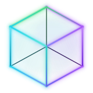
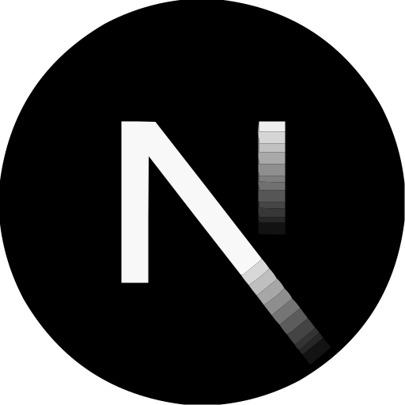
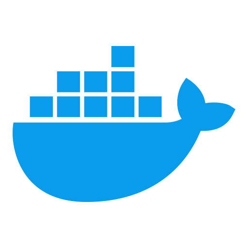

# <div align="center">  <br> Nucleify <br> </div>
<br>

**Build once. Move to any framework.** Vue · React · Nuxt · Next · Astro · Svelte · Solid — without rewriting your product.

Locked into one stack? Changing frameworks usually means a costly rewrite. Nucleify keeps your product in shared modules, so you can migrate from one technology to another when the market, team, or client asks for it.

| Ready to run on |
| --- |
| **Vue** · **React** · **Nuxt** · **Next** · **Astro** · **Svelte** · **Solid** |

> One product. Any shell. Not stuck on React/Next or Vue/Nuxt alone.

Three surfaces, one nucleus: **web**, **admin**, and **docs** — each can move to another framework when you need it. 

Backend on **Supabase**.
UI with [nucleify-ui](https://www.npmjs.com/package/nucleify-ui).

**Build portable products. Join the nucleus.**

<br><a href="https://nucleify.io">Live preview</a> · <a href="https://docs.nucleify.io/en/docs/getting-started/introduction">Docs</a> · <a href="https://nucleify.io/en/investor">Investor brief</a><br><br>

⭐ **Any stack → any other** — migrate without rewriting the business <br>
⭐ **Shared modules** — API, SQL, and UI stay one product across shells <br>
⭐ **Portable compiler** — write once, emit Vue / React / Solid / Svelte and more <br>
⭐ **One-command setup** — `make run` + `make web` from the repo root <br>
⭐ **Modern UI** — [nucleify-ui](https://www.npmjs.com/package/nucleify-ui) + design tokens ready to brand <br>

<br>
<hr>

### Quick start

```bash
git clone --recurse-submodules https://github.com/Nucleify/Nucleify.git
cd Nucleify
# Private `compiler/` submodule: needs access to Nucleify/nucleify-compiler
make run          # .env, install, husky, compiler
make web          # Nuxt product shell (default)
# make web TARGET=next     # Next product shell
# make web TARGET=solid    # Solid product shell
# make web TARGET=svelte   # Svelte product shell
# make vue | react | nuxt | next | solid | svelte   # portable emit demos
```

Open http://localhost:3000 after `make web`. Fill `SUPABASE_*` in `.env` (from `web/.config/.env.example`) before using the API.

Full guide: [Installation](https://docs.nucleify.io/en/docs/getting-started/installation).

<hr>
<br>

<details><summary> <h2> &nbsp;  &nbsp; Tech Stack </h2> </summary> <br>
<div align="center">
  <a href="https://vuejs.org/" target="_blank"></a>
  <a href="https://react.dev/" target="_blank"></a>
  <a href="https://nuxt.com/" target="_blank"></a>
  <a href="https://nextjs.org/" target="_blank"></a>
  <a href="https://astro.build/" target="_blank"></a>
  <a href="https://svelte.dev/" target="_blank"></a>
  <a href="https://www.solidjs.com/" target="_blank"></a>
  <a href="https://www.typescriptlang.org/" target="_blank"></a>
  <a href="https://supabase.com/" target="_blank"></a>
  <a href="https://www.docker.com/" target="_blank"></a>
  <a href="https://www.cloudflare.com/" target="_blank"></a>
  <a href="https://vitest.dev/" target="_blank"></a>
  <a href="https://biomejs.dev/" target="_blank"></a>
  <a href="https://stylelint.io/" target="_blank"></a>
  <a href="https://github.com/features/actions" target="_blank"></a>
</div>

<p align="center"><strong>Shells:</strong> Vue · React · Nuxt · Next · Astro · Svelte · Solid<br /><em>Not a React/Next-only or Vue/Nuxt-only product — seven emit targets from one nucleus.</em></p>

<hr><br></details>

<details><summary> <h2> &nbsp;  &nbsp; Contribute </h2> </summary> <br>

Feel free to check the [Issues](https://github.com/Nucleify/Nucleify/issues) section.
Your skills help us ship a nucleus that stays portable across **all seven** modern web targets.

<br></details>

<br>
<hr>

<div align="center">

<h3>Contributors</h3>

<a href="https://github.com/SzymCode" target="_blank"></a>
<a href="https://github.com/KatarzynaS97" target="_blank"></a>
<a href="https://github.com/K4mD4m" target="_blank"></a>
<a href="https://github.com/J0jeQ" target="_blank"></a>
<a href="https://github.com/JakubMalik" target="_blank"></a>
<a href="https://github.com/kbujak09" target="_blank"></a>
<a href="https://github.com/karol199393" target="_blank"></a>
<a href="https://github.com/domizalewska" target="_blank"></a>
<a href="https://github.com/kbloski" target="_blank"></a>
<a href="https://github.com/Kacper658" target="_blank"></a>
<a href="https://github.com/dezmerek" target="_blank"></a>
<a href="https://github.com/pysifoo" target="_blank"></a>

</div>
